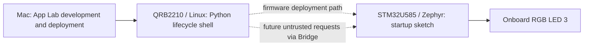

# AEGIS architecture — Step 1

## Scope and implemented state

AEGIS explores independent MCU validation of requests originating in a less-trusted Linux environment. Step 1 establishes the app layout, processor boundary, and an observable MCU startup sequence. It does not yet implement command handling, safety rules, timeouts, heartbeat, authentication, dashboard, or actuator control. No external circuit, simulated actuator, or cloud service is involved.

Arduino UNO Q combines a Qualcomm QRB2210 running Debian Linux with an STM32U585 running Arduino sketches on Zephyr. The [UNO Q manual](https://docs.arduino.cc/tutorials/uno-q/user-manual/) identifies RGB LEDs 1/2 as MPU-controlled and 3/4 as MCU-controlled. This app uses only LED 3 through `LED3_R`, `LED3_G`, and `LED3_B`, with `pinMode` and `digitalWrite`. LOW lights a channel; HIGH turns it off. These symbols were also checked in the installed UNO Q core's `variant.h`.

Dashed request flow is planned, not implemented. The deployment path is a privileged maintenance capability and prevents treating the two processors as an immutable security boundary.

## Responsibility boundary

| Component | Step 1 responsibility | Intended future responsibility |
| --- | --- | --- |
| Linux / Python | Print one startup message and remain under App Lab lifecycle control using `App.run()` | Produce high-level requests and display/log MCU-reported outcomes; never decide that a request is safe on the MCU's behalf |
| MCU / sketch | Configure LED 3, wait 500 ms, flash green three times (250 ms on / 250 ms off), then leave green on | Own validated output state, validate bounded requests, enforce local limits and a defined safe state using MCU-local time |
| Bridge / Router | No application RPC endpoints or calls | Transport requests and results; transport availability or successful delivery is not permission to actuate |
| App Lab / toolchain | Build, deploy, and supervise the app | Trusted provisioning and maintenance tooling, separate from the runtime request interface |

The sketch does not wait for Python, a serial monitor, or a Bridge handshake. Board bootloader, Zephyr startup mode, and App Lab deployment can still depend on Linux. This is not a claim of independent power, reset, or boot. LED 4, MPU LEDs, the matrix, and header pins are not controlled by AEGIS Step 1.

Green means only that the sketch reached the final statement of `setup()`. An MCU that hangs afterward can leave the same green output. GPIO initialization may produce brief transients before the deliberate sequence; no glitch-free initialization guarantee is made. The LED is not a watchdog, safety output, or self-test of the complete board.

## Realistic threat model

The future protected asset is the MCU-owned output state and the integrity of MCU-side decisions. For this onboard-only milestone, the observable asset is simply LED 3; there is no load to make safe.

| Threat or failure | Intended treatment / present limit |
| --- | --- |
| Buggy or malicious Linux application submits invalid, excessive, stale, replayed, or out-of-order requests | Treat every request as untrusted; future firmware must check types, ranges, state transitions, freshness, and workload bounds locally. None of these checks exists yet. |
| Linux application exits, stalls, or lies in logs | Future output decisions must not rely on host logs or timing. Step 1's startup pattern is MCU-local; Linux logs do not prove MCU state. |
| Router failure, dropped/delayed messages, or request flooding | Future bounded processing and MCU-local expiry behavior require explicit tests. Separate processors do not by themselves prove availability or timing bounds. |
| Compromised root, deployment tooling, or firmware update authority | Outside the claimed runtime boundary. Linux participates in MCU programming; replacement firmware or reset can defeat application checks. No secure-boot, signed-update, debug-lock, or anti-rollback protection has been configured or verified here. |
| MCU parser/firmware/core vulnerability | Trusted computing base failure. Future use of Bridge adds its MCU library and deserializer to that base; validation alone cannot prove these bug-free. |
| Power loss, shared power/reset disruption, physical access, malicious reflashing, electrical faults | No resilience guarantee. This board has no external interlock or independent energy-isolation mechanism in this project. |

The proposed guarantee is conditional: while the intended MCU firmware is intact and running, Linux-originated requests should be unable to bypass its policy. It is not a claim that a stock UNO Q withstands arbitrary OS-level takeover. Stronger isolation would require a separate review of programming/reset paths and verified firmware protections. This proof of concept is not a certified safety controller.

## Bridge design reference, deferred implementation

The [Bridge API reference](https://docs.arduino.cc/software/app-lab/bridge/bridge-api) specifies MessagePack RPC through `arduino-router`, with `/dev/ttyHS1` and `Serial1` reserved for that link. Future application code must not open those interfaces directly. The documented 256-byte message limit is a transport constraint, not input validation.

The official [Python-to-sketch example](https://github.com/arduino/app-bricks-examples/tree/main/core-and-foundational/03-bridge-basics/01-call-sketch-function-from-python) shows `Bridge.call`, `Arduino_RouterBridge.h`, `Bridge.begin`, and endpoint registration. The current API reference warns that `provide` callbacks run on the RPC thread and must not issue nested Bridge/Monitor calls; `provide_safe` is documented for main-loop execution. The example's Monitor call inside `provide` conflicts with that warning. Do not copy that callback into the next milestone; verify the installed library behavior and select a bounded handoff design first.

Step 1 deliberately imports no Bridge class, initializes no MCU Bridge transport, and exposes no remote output-setting method. The official [MCU blink app](https://github.com/arduino/app-bricks-examples/tree/main/core-and-foundational/01-led-blink/01-blinking-an-LED-mcu) confirms that an MCU-only sketch with a Python `App.run()` shell is an established pattern.

## Application contract

The repository root follows the [Arduino App specification](https://github.com/arduino/arduino-app-cli/blob/main/docs/app-specification.md): root `app.yaml`, `python/main.py`, and both sketch files. The manifest has no exposed ports and an empty Bricks list. App Lab supplies `arduino.app_utils`; no separate pip package is requested. The [sketch profile format](https://arduino.github.io/arduino-cli/1.3/sketch-project-file/) selects `arduino:zephyr:unoq` and pins the tested platform to 1.0.0, with RouterBridge 0.4.3 and its dependencies explicitly pinned for isolated profile builds. The core requires RouterBridge during library discovery even though Step 1 exposes no application RPC endpoint. Board-side profile compilation passed; upload and runtime behavior remain unverified.

References reviewed on 2026-10-22. Documentation and upstream `main` can change; the locally tested core version is recorded in PROGRESS.md.

## Step 2 extension — separate app

The preceding implementation description remains the root Step 1 baseline. `apps/step2` is now an independent App Lab root named **AEGIS Step 2**. It initializes Bridge and registers only `aegis.command` with `provide_safe`. Linux sends two int32 values: correlation ID and green/blue command. The MCU changes LED 3 in the safe handler and returns `[1, request_id, status, led_code, accepted_count]`. See [the exact contract and acceptance procedure](STEP2.md).

The application handler does constant work and returns a fixed-size array. No command delays, Monitor calls, nested Bridge requests, dynamic response containers, heartbeat, or policy controller were added. The library's main-loop hook dispatches safe requests after the empty sketch loop returns. Application-level acceptance confirms that GPIO writes were issued and an acknowledgement received; physical light must still be observed. Correlation IDs and the saturating accepted-command counter are diagnostics, not authentication, replay protection, or a boot identifier.

The installed RouterBridge 0.4.3 implementation returns booleans from `begin` and `provide_safe` (the general documentation describes no return value). This app checks those installed APIs. It sends one best-effort startup log through `Bridge.notify(MON_WRITE_METHOD, message)`, the same notification used by the installed `Monitor.write` implementation. It does not call `Monitor.begin` or wait for a monitor reply. Bridge initialization/registration RPCs can still block; this milestone makes no bounded startup/recovery guarantee. Current official Python `Bridge.call` supports a finite `timeout`; the client checks for that API before sending and fails explicitly on an older runtime. No direct Router UART access is used.

The physical Step 1 checks remain pending. Step 2 code compilation and offline tests are recorded separately from the still-pending physical RPC acceptance in PROGRESS.md.
